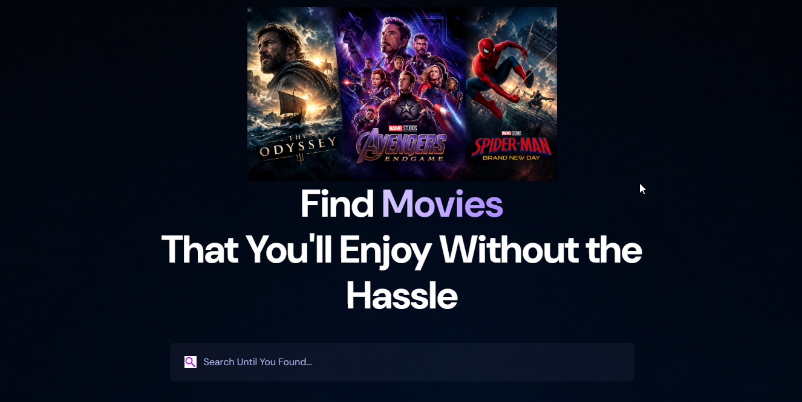
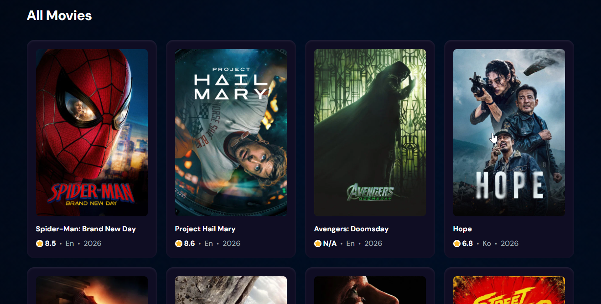

This is the project I Created by myself for a course I took for React and the things I learned in this course are as following 
1- I learned how to use HTML/CSS properly, Use them how ever I want
2- I learned the more complex way of using UseState and UseEffect
3- I learned how to fetch Data from an API and call it and display the data on the website dynamically 
4- Overall I understand a lot during taking this course

## 📸 Screenshots

